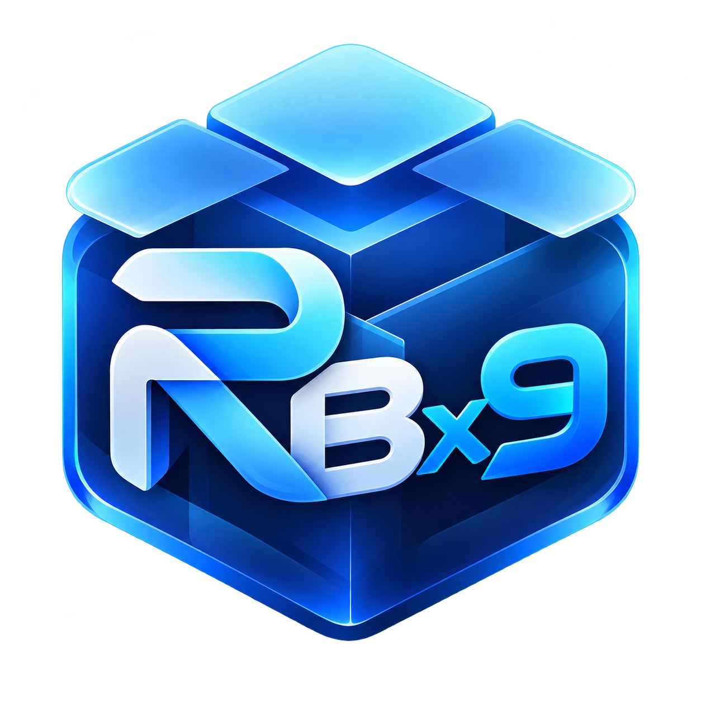

# RBx9 Repo

A reusable Sileo / APT repository for jailbreak tweaks developed by **RBx9**. Current DuoBar editions: **RootHide v2.7.2** and **Rootless v2.7.2** for iOS 16.0–16.7.x (Rootless covers Dopamine and palera1n).

**Both RootHide and Rootless installers are published under [one v2.7.2 GitHub release](https://github.com/RBx9/DuoBar/releases/tag/v2.7.2).** Choose the package matching your jailbreak.

**Sileo source URL:**
https://rbx9.github.io/

## Install in Sileo
1. Open Sileo → Sources → +.
2. Paste `https://rbx9.github.io/`.
3. Refresh sources, choose **RBx9 Repo**, and install a compatible package.

This is a personal repository, **not affiliated with Sileo or RootHide**.
